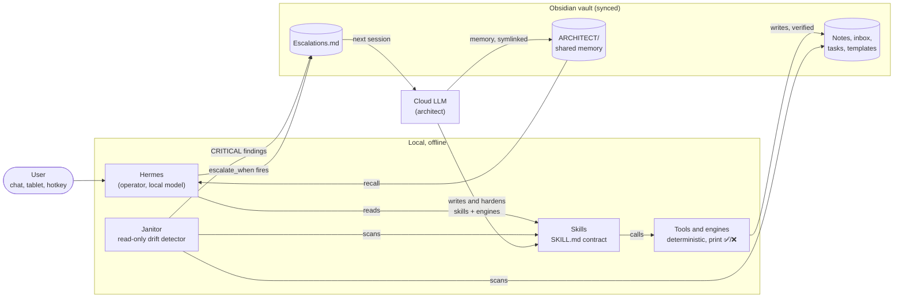

# agent-skills

A two-agent operating system for a personal knowledge vault: **a cloud LLM is the architect, a small local model is the operator**, and a skill contract with earned autonomy and mandatory verification sits between them.

**Status:** in daily use in the author's setup since mid-2026 (an Obsidian vault, [Hermes Agent](https://github.com/NousResearch/hermes-agent) on a local Ollama model, a cloud LLM coding agent). This repo is a curated extract: the skill contract, 14 generic skills (plus a usage skill for one plugin), the engines they call and 6 tool plugins. The author's calendar, email, contacts and finance layers are not included. The deterministic engines (janitor, template engine, migrator, task board, memory sync, self-test) were run against the bundled example vault for this release; recall and the LLM-backed plugins need a local Ollama to try.

<!-- MEDIA: a screenshot of the morning brief as it arrives in a Discord DM — the `myos_janitor_scan.py --brief` lines followed by the `myos_selftest.sh` ✅/❌ block. Crop to the message; no server or user names visible. -->

## What it does

- **Runs routine vault work offline.** A local model (Hermes on Ollama) captures thoughts, files notes, adds tasks, answers questions from your own notes and runs a weekly review, without a cloud model in the loop.
- **Escalates instead of guessing.** When a skill's `escalate_when` condition fires, the local model writes a structured entry to an escalation queue and stops. The cloud LLM resolves it next session.
- **Grades its own skills.** Every skill carries `status: draft|published` and a `confidence` score. Skills start as drafts and graduate when they have run clean unattended.
- **Refuses to say "done" without proof.** Every skill ends with a Verification section naming an observable signal. Tools print ✅/❌ and the model relays that line, not its own summary.
- **Watches for drift.** A read-only janitor scans the vault every morning: unfiled inbox items, notes missing frontmatter, broken path links, a duplicated "Inbox" folder, a skill that vanished, a template edit that broke a feature. Each finding names the skill that fixes it; critical ones go straight to the architect's queue.
- **Shares one brain between both agents.** The cloud agent's memory files live in the vault (symlinked back into its memory directory), so the local model can read and cite what the cloud model knows, and both sync across devices.
- **Answers from your notes with citations.** Hybrid semantic + lexical recall over the vault with a local embedding model, falling back to lexical search if the model is down.
- **Adds safe system tools to chat.** Check and apply system updates, find and install programs, explain a math or programming topic in your study style, turn a goal into a plan, schedule reminders, drop a note into the inbox. Anything that needs root comes back as a command for you to run.

<!-- MEDIA: a terminal recording (asciinema or a GIF) of `python engines/myos_janitor_scan.py` against examples/vault, then the same scan after deleting the "### Checklist" heading from Templates/Daily.md — showing the 🚨 feature-contract finding and the new entry appended to ARCHITECT/Escalations.md. -->

## How it works



### Two agents, two jobs

The design goal is that the system keeps working for years even if the cloud model goes away. That splits the work cleanly:

- **Hermes (operator)** owns routine, deterministic work: capture, filing, tasks, recall, the weekly pass. It runs on a small model that fits an 8 GB GPU, so every skill is written to be followed by a model that can't reason its way out of an ambiguous instruction.
- **Cloud LLM (architect)** owns design, ambiguous judgment, multi-step reasoning, debugging and new-skill authoring. It builds and hardens the skills Hermes runs.

The rule that makes this work: **a skill never asks the small model to improvise.** If a step needs judgment, the skill says "leave it, flag it, escalate".

### Escalation is the safety valve

[`escalate-to-architect`](skills/myos/escalate-to-architect/SKILL.md) appends an entry to `ARCHITECT/Escalations.md` with the context, what was tried, why it stopped, and `Status: OPEN`. It's a file, so it works offline and survives restarts. The cloud LLM reads the queue at the start of a session, resolves items and marks them done. The janitor writes to the same queue when it finds a critical breakage, so the architect has one inbox.

A kind of escalation that keeps recurring is the signal to write a new skill. That's the trust ladder: repeated escalations graduate into owned skills.

### Earned autonomy

Every skill's frontmatter states who can run it (`runner: hermes | architect | either`), whether it's proven (`status: draft | published`), how battle-tested it is (`confidence: 0.0–1.0`), and exactly when to stop (`escalate_when`). The fields make trust legible: a draft skill at 0.5 is one the owner still watches; a published skill at 0.9 runs unattended. The full contract is in [docs/skill-contract.md](docs/skill-contract.md).

### Verification first

Each `SKILL.md` has a mandatory `## Verification` section with an observable check: the line is at the tail of the file, the tally balances, the output ends with a sources line. This exists because the local model used to report success it never achieved. Two changes fixed it:

1. **Flaky actions became tools, not instructions.** A 4B model reliably *calls tools* even when it won't *follow procedures* — it once hand-wrote a file into a folder it invented instead of running the script that owned the path. So anything that writes (a task, a note, a reminder) goes through a script that does the write, checks it on disk and prints ✅ or ❌. The skill tells the model to relay that line verbatim.
2. **A live self-test.** [`myos_selftest.sh`](engines/myos_selftest.sh) exercises each capability (writes and removes a file in the inbox, renders every template, asks the model server, lists loaded skills) rather than reading status flags. It grew a check for each thing that once failed silently.

### The janitor: manager, not worker

[`myos_janitor_scan.py`](engines/myos_janitor_scan.py) never edits a note. It emits a punch-list where every finding names the skill that fixes it, so detection is always safe and fixing stays earned per skill. Most of its checks exist because something broke quietly:

- **A skill vanished.** A skill directory was deleted mid-session (a cat on the keyboard) and nothing noticed until a manual count. Now an expected-skills manifest turns that into a finding.
- **A skill silently stopped loading.** If a `SKILL.md` frontmatter isn't valid YAML, Hermes falls back to a line parser, `platforms: [linux]` becomes a string, and the skill drops out of the index with no error. One stray `: ` in a value is enough. The janitor parses every frontmatter.
- **A second Inbox appeared.** The local model invented `Vault/Inbox` and wrote captures there, splitting data. Every operational folder must exist at exactly one path; a duplicate is critical.
- **A template edit broke a feature.** The owner deletes how-to callouts after learning a feature and restyles templates constantly, so feature knowledge can't live only in the note. Each template↔code coupling becomes a contract in `contracts.json` (a file plus the markers it must keep); a broken one is critical and auto-escalates. The owner can restyle anything without fear.
- **Memories disappeared.** The cloud agent's `MEMORY.md` index is loaded whole each session and truncates past about 24 KB without an error. It grew two ways: new memories (fine) and existing one-line entries fattening as projects advanced — from 402 to 565 bytes per entry with no new entries added. Rewriting the index as one hook per memory brought it to 228 bytes per entry. The janitor now warns at 15 KB, goes critical at 17 KB, and flags entries drifting past 400 bytes.

### One brain for both agents

The cloud coding agent keeps its memory as markdown files in a per-project directory. [`myos_memory_sync.sh`](engines/myos_memory_sync.sh) moves each real file into the vault's `ARCHITECT/<Category>/` folder and leaves a symlink behind, relinks files that arrive from another device, and prunes dead links. There's one copy of every memory, it syncs with the vault, the owner can edit it in Obsidian, and Hermes's recall searches it. The janitor flags any memory that ends up as a real file on both sides, because two copies drift. A restore script undoes the whole arrangement.

### Recall

[`architect_powers.py recall`](engines/architect_powers.py) answers a question from the vault only, with `[[citations]]`. Note selection is a hybrid ([`myos_semrecall.py`](engines/myos_semrecall.py)): cosine similarity from a local embedding model blended 0.65/0.35 with a TF-IDF score that weights rare terms, so "typeface" finds the font-config note. The embedding index is incremental by content hash. If numpy, Ollama or the index is unavailable, it falls back to lexical ranking, says so in its sources line, and still answers.

### Walls hit along the way

- **The model forgot everything.** Hermes replied in garbled mixed languages and denied having tools it had. The memory pipeline was fine: `ollama ps` showed the model loaded at a 4096-token context, because Ollama's OpenAI-compatible endpoint ignores `num_ctx`. The roughly 7k-token system prompt was being truncated, cutting off the tool definitions and memory. The fix is a Modelfile that bakes the context size into the model.
- **Too many tools sank the small model.** Hermes's Discord toolset list is an explicit allowlist that had left out every custom plugin. Adding them all made 31 toolsets, which overwhelmed a 4B model; trimming to a lean 17 brought tool calls back.
- **Deterministic first.** Date math is a classic small-model failure ("the 21st" resolved to the wrong ISO date), so [`myos_dates.py`](engines/myos_dates.py) parses every natural date in stdlib and the skills forbid the model from computing one. Templater expressions get the same treatment: [`myos_apply_template.py`](engines/myos_apply_template.py) renders the bounded subset the templates use, outside Obsidian, and leaves anything unsupported in place for the janitor to flag.
- **Root needs a human.** The system updater and program installer only act autonomously on per-user Flatpaks. Official and AUR packages come back as the exact `paru -Syu` or `pacman -S` command with a risk summary (kernel, graphics, core packages, reboot needed) for the owner to run, because an unattended system upgrade is how Arch installs break.

## Built with AI agents

- **The repo is the handoff.** The cloud LLM wrote and hardened the skills and engines; Hermes runs them. Skills are written for the weaker agent to follow, and anything the weaker agent can't decide is routed back to the stronger one through a file both can read.
- **A tool so the agent can see results.** The self-test and the janitor exist so an agent can check the system's real state instead of asserting it. Every tool prints a ✅/❌ line the operator relays verbatim, which is what stopped the local model from reporting work it hadn't done.
- **Debugging from transcripts.** The cloud LLM diagnosed the local agent's failures by reading its stored session transcripts and checking the running model (`ollama ps`), which is how the 4096-token truncation was found.
- **Shared memory as a coordination layer.** The cloud LLM's memory lives in the vault, so the operator can cite the architect's notes and both agents resume from the same anchors (the `resume` skill reads them in a fixed order).

## Requirements

- Linux, Python 3.10+
- [Obsidian](https://obsidian.md) vault (plain markdown; Obsidian itself isn't needed to run the engines)
- [Hermes Agent](https://github.com/NousResearch/hermes-agent) for the skills and plugins
- [Ollama](https://ollama.com) with a chat model (default `qwen3:8b`) and an embedding model (`all-minilm`)
- Python packages: `requests`, `numpy` (recall), `pyyaml` (the janitor's YAML check; optional)
- Optional: a local [SearXNG](https://github.com/searxng/searxng) for web grounding; `flatpak`, `paru` or `yay` for the system tools (Arch-based distros)
- Optional: a cloud LLM coding agent that keeps its memory as Markdown files, as the architect

## Install

```bash
git clone https://github.com/CipherNovaa/agent-skills.git ~/agent-skills
cd ~/agent-skills
pip install --user requests numpy pyyaml

# 1. Describe your vault layout (every engine reads this one file).
mkdir -p ~/.config/myos
cp config/paths.example.json ~/.config/myos/paths.json      # edit "vault" and "architect_memory_dir"
cp config/contracts.example.json ~/.config/myos/contracts.json
export MYOS_ENGINES=~/agent-skills/engines                   # see .env.example for the rest

# 2. Check the spine resolves.
python engines/myos_paths.py

# 3. Give Hermes the skills: in ~/.hermes/config.yaml
#      skills:
#        external_dirs: [~/agent-skills/skills]
hermes skills list | grep myos

# 4. Give Hermes the plugins, then add each name to plugins.enabled in config.yaml
#    (it's an allowlist: a plugin directory does nothing until it's listed there).
for p in plugins/*; do ln -s "$PWD/$p" ~/.hermes/plugins/; done

# 5. Models.
ollama pull qwen3:8b && ollama pull all-minilm
python engines/myos_semrecall.py index
```

To try the engines without touching a real vault, point them at the example vault:

```bash
export MYOS_VAULT=$PWD/examples/vault MYOS_SKILLS_DIR=$PWD/skills/myos
python engines/myos_janitor_scan.py
python engines/myos_task.py add "Renew the domain" --due monday
python engines/myos_migrate_note.py --all          # dry run
```

## Usage

| Command | What it does |
|---|---|
| `python engines/myos_janitor_scan.py [--brief] [--escalate]` | Read-only drift scan; `--escalate` queues critical findings |
| `python engines/myos_janitor_scan.py --bless` | Accept the current skill set as expected |
| `bash engines/myos_selftest.sh` | Live capability check, ✅/❌ per line |
| `python engines/architect_powers.py recall "<question>"` | Answer from the vault with citations |
| `python engines/myos_task.py add "<text>" --due friday` | Add a task to the board |
| `python engines/myos_apply_template.py "<Template>" "<Title>" --dir journal` | Render a Templater template outside Obsidian |
| `python engines/myos_migrate_note.py --all [--apply]` | Add `type:` frontmatter to old notes, body untouched |
| `bash engines/myos_memory_sync.sh` | Mirror the cloud agent's memory into the vault (idempotent) |

A morning brief is two lines in a script under `~/.hermes/scripts/` (Hermes's no-agent cron jobs run scripts from there and deliver their stdout verbatim):

```bash
#!/usr/bin/env bash
# ~/.hermes/scripts/myos_morning.sh
python ~/agent-skills/engines/myos_janitor_scan.py --brief --escalate
bash ~/agent-skills/engines/myos_selftest.sh
```

```bash
hermes cron create "0 8 * * *" --no-agent --script myos_morning.sh --deliver discord --name myos-morning
```

### Adopting the template

1. Copy [`skills/SKILL-TEMPLATE.md`](skills/SKILL-TEMPLATE.md) to `skills/myos/<name>/SKILL.md`.
2. Write `description` as a trigger ("Use when …") — it's what routing matches on.
3. Put every write behind a tool that verifies it, and say in Pitfalls when to stop and escalate.
4. Write a Verification section a stranger could check.
5. Start at `status: draft`, `confidence: 0.5`. Promote it after it has run clean unattended.
6. Run `myos_janitor_scan.py --bless`.

## What's in the repo

```
skills/
  SKILL-TEMPLATE.md        the contract every skill follows
  myos/                    14 skills: escalate-to-architect, janitor, recall, capture,
                           capture-to-inbox, process-inbox, file-note, migrate, task,
                           weekly-review, scan, selftest, resume, interview-me
  tools/                   learn-accelerator (how to use the learn plugin)
engines/                   the deterministic scripts the skills call (stdlib where possible)
plugins/                   Hermes tool plugins: system-updater, program-installer,
                           learn-accelerator, idea-planner, reminders, note
config/                    paths.example.json, contracts.example.json, learning_style.example.md
examples/vault/            a tiny vault to run the engines against
docs/skill-contract.md     the frontmatter and section contract in full
```

Skills with design history keep it in a sibling `NOTES.md`, so the runtime file stays short for the small model.

## Credits and licence

- [Hermes Agent](https://github.com/NousResearch/hermes-agent) by Nous Research (MIT) — the local agent runtime; the plugins use its `register(ctx)` plugin API and its cron.
- [Odysseus](https://github.com/pewdiepie-archdaemon/odysseus) (AGPL-3.0) — the skill section names and earned-autonomy fields follow its skill format, and the idea of semantic memory over local embeddings came from studying it. No Odysseus code is included.
- [Ollama](https://ollama.com), [SearXNG](https://github.com/searxng/searxng), [Obsidian](https://obsidian.md) and the Templater, Tasks and Kanban plugins whose formats the engines read and write.

MIT licence — see [LICENSE](LICENSE). Copyright (c) 2026 CipherNovaa.
